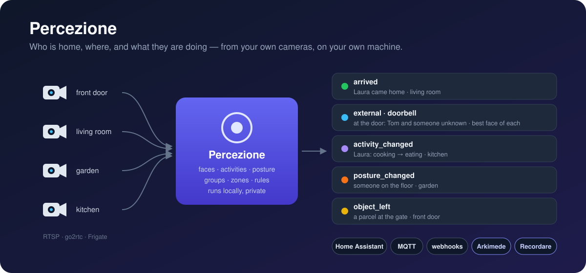

# Percezione

**Who is home, where, and what they are doing — from your own cameras, on your own machine.**

*[Italiano](README.it.md)*

<p align="center"></p>

Percezione turns IP cameras into events about people: who arrived, who left, who is at the door, what someone is
doing in a room, when someone walks by outside or leaves a parcel at the gate. It runs locally on top of
[Frigate](https://frigate.video) and [go2rtc](https://github.com/AlexxIT/go2rtc). It sends what it sees to Home
Assistant, MQTT, webhooks or AI agents (MCP), and it is configured entirely from its web UI.

## Contents

1. [What it does](#what-it-does)
2. [How it fits together](#how-it-fits-together)
3. [Arkimede and Recordare](#arkimede-and-recordare)
4. [Requirements](#requirements)
5. [Installation](#installation)
6. [First start](#first-start)
7. [Configuration](#configuration)
8. [Connecting other systems](#connecting-other-systems)
9. [Updates and backup](#updates-and-backup)
10. [Security](#security)
11. [Documentation](#documentation)
12. [Development](#development)
13. [License](#license)

## What it does

- **Cameras:** added from the UI (an RTSP address, or imported from a go2rtc you already have). One connection per
  camera, shared by detection, the live view and, if you want, other apps.
- **People:** a person is a name with a few face photos. Faces seen by the cameras and not recognized wait in a
  "to name" box; naming them teaches the system. Night (infrared) faces are kept apart, so recognition works in the
  dark too.
- **Events** (schema v3):

  | Event | When |
  |---|---|
  | `arrived`, `left` | A person enters or leaves a place |
  | `activity_changed` | What a person is doing changes (optional vision-language model) |
  | `posture_changed` | Standing, sitting, lying, on the floor (optional posture model) |
  | `passage`, `approach` | Someone walks by outside, or comes to the entrance |
  | `object_left` | Something is left in a zone (a parcel, the bins) |
  | `external` | A device says something happened at a camera (a doorbell ring, a call, a gate opening) |

- **Camera groups and the short memory:** cameras that look at the same place from different points answer
  together. When a device reports an external event, Percezione looks at the seconds before and after it and returns,
  for each person, the frame where their face was seen best.
- **Rules:** decide which events matter, when, and for whom. Reactions are: notification, memory, voice
  announcement, Home Assistant, webhook.
- **Outputs:** MQTT with Home Assistant discovery, signed webhooks with an outbox so nothing is lost, live events over
  SSE (`/events`), and an MCP server for agents with read-only tools: `who_is_where`, `who_is_at`, `events`,
  `people`, `cameras`, `camera_snapshot`.
- **Ask who is there:** `who_is_at(camera or group)` over MCP, HTTP or MQTT, with each person's face if asked.
- **Backup and restore** of configuration, people and faces in one file.

Percezione recognizes; it never acts. Opening doors or other physical actions stay in your home automation. A
recognized name is information, never a permission.

## How it fits together

```
cameras ──RTSP──▶ go2rtc ──▶ Frigate (detection, tracking, faces) ──MQTT──▶ Percezione ──▶ MQTT / Home Assistant
                    │                                                         │          ──▶ webhooks, /events (SSE)
                    └──────────── live view, other apps (optional) ◀──────────┘          ──▶ MCP (agents)
                                                     optional: Ollama (activities), onnx-runner (posture, objects)
```

Everything runs with Docker Compose:

| Service | Role |
|---|---|
| `percezione` | The service and its web UI (port 8090), Frigate's UI behind its login (port 8091) |
| `go2rtc` | One connection per camera; the video for Frigate, the live view and other apps |
| `frigate` | Detection, tracking and face recognition |
| `mosquitto` | MQTT broker, reachable only inside Compose (you can use your own instead) |
| `setup` | Runs once at every start: creates the secrets and the base configuration, never overwrites |
| `ollama` (profile `vlm`) | The vision-language model for activities |
| `onnx-runner` (profile `pose`) | Posture (RTMPose) and left-object classification (CLIP) |

## Arkimede and Recordare

Percezione works on its own, with Home Assistant, MQTT or any MCP client. It was built as the eyes of a family of
three self-hosted projects that work best together:

| Project | Role |
|---|---|
| **Percezione** (this one) | **Sees:** who is home, where, what they are doing, who is at the door |
| [**Arkimede**](https://github.com/arkimedehq/arkimede) | **Acts:** the AI agent platform. Its Percezione plugin follows the events live, tells the right person, speaks in a room and answers "who is at the door?" with the face |
| [**Recordare**](https://github.com/arkimedehq/recordare) | **Remembers:** the long-term memory of each person. What the cameras saw becomes a *perception*, remembered as seen and left to fade; a presence tells the memory that someone is there, the right moment to remind them of something |

Together: a camera sees Laura come home, Arkimede greets her in the kitchen and reminds her of what she planned for
the evening, and later she can ask "who rang while I was out?". Each project runs alone; none needs the others.
Setup: [docs/arkimede-plugin.md](docs/arkimede-plugin.md).

## Requirements

- **Machine:** Linux on x86-64 or ARM64, always on. 4 GB of RAM for a few cameras on the CPU; 16 GB or more with the
  activity model. An SSD for the system.
- **Software:** Docker Engine with the Compose plugin ([install guide](https://docs.docker.com/engine/install/); not
  the snap package).
- **Cameras:** IP cameras with an RTSP stream, with their address, user and password. A second, lighter stream is
  welcome for previews.
- **Optional:** an accelerator (NVIDIA GPU, Intel GPU or NPU, Google Coral), a GPU with 8 GB or more for the activity
  model, an MQTT broker of your own (e.g. Home Assistant's).

## Installation

```sh
git clone https://github.com/arkimedehq/percezione.git
cd percezione/deploy
cp .env.example .env      # optional: time zone, ports, a broker of your own
docker compose up -d
docker compose logs -f setup percezione
```

Nothing has to be configured beforehand. On first start, the `setup` service creates the passwords between the
services (in `deploy/data/secrets`, readable only by their owner) and the base configuration of Frigate, go2rtc and
Mosquitto. Set `TZ` in `.env` (e.g. `TZ=Europe/Rome`) so that event times are local.

### Hardware

Detection runs on the CPU by default. To use an accelerator, add its file:

| Hardware | Command | Notes |
|---|---|---|
| CPU | `docker compose up -d` | Fine for 1–3 cameras at 5 fps |
| NVIDIA GPU | `docker compose -f docker-compose.yml -f hardware/nvidia.yml up -d` | Needs the NVIDIA driver and Container Toolkit. The first start exports a YOLOv9 model on your machine (a few minutes) |
| Intel GPU / NPU | `docker compose -f docker-compose.yml -f hardware/intel.yml up -d` | OpenVINO, 6th gen Intel and newer |
| Google Coral | `docker compose -f docker-compose.yml -f hardware/coral.yml up -d` | USB by default; PCIe in the file |
| Intel iGPU + NVIDIA | `docker compose -f docker-compose.yml -f hardware/intel.yml -f hardware/ollama-nvidia.yml --profile vlm up -d` | Frigate on the Intel GPU, the whole NVIDIA card for the vision model |

### Optional parts

```sh
docker compose --profile vlm up -d    # Ollama: activities (eating, reading, at the computer…)
docker compose --profile pose up -d   # onnx-runner: posture, falls (on the floor)
```

- **Activities:** Ollama starts with no model; Percezione downloads the one it is set to by itself (about 3 GB for
  the default `qwen3-vl:4b-instruct`; `qwen3-vl:8b-instruct` is more accurate with 8 GB of GPU memory). The
  **Analyzers** page shows the progress; activities start when it is done.
- **Left objects:** also need CLIP: set `ONNX_MODELS=pose clip` in `.env` before starting the `pose` profile.

Profiles and hardware files combine: use the same `-f` and `--profile` options every time you run `docker compose`.

### Ports

| Port | What |
|---|---|
| 8090 | Percezione: UI and API |
| 8091 | Frigate's UI, behind Percezione's login |
| 8554, 8555 | RTSP and WebRTC of the cameras for other apps, only when sharing is on |

Frigate's API, go2rtc's API and Mosquitto are not exposed. The full guide covers prerequisites for each type of
hardware, a broker of your own, updates, troubleshooting and uninstalling: [docs/install.md](docs/install.md).

## First start

1. **Password:** open `http://<this machine>:8090` and choose the password (at least 8 characters). Whoever opens the
   page first chooses it, so do it right after the install.
2. **Cameras → Add camera:** the RTSP address of the camera (the password is asked separately and never shown again),
   a test of the stream, then a name, a place (the room) and a type: indoor or outdoor.
3. **Edit the camera:** draw the zones that matter (the sofa, the entrance) and the masks for what moves but does not
   matter (the camera's clock, trees), then choose what to observe.
4. **People:** create the people of the house with 5–10 clear, front-facing photos each. On its first start Frigate
   downloads its face models (about 320 MB): until then every photo is refused with "No face was detected"; wait a
   few minutes and try again.
5. **Rules** and **Outputs:** choose what you want to be told about, and where.

A guide on the Home page walks through these steps, and every page has a help panel (the **?** button).

## Configuration

Every option is set from the UI. `.env` holds only ports, addresses and hardware; the secrets are created by `setup`.
Each saved change is a new version of `data/config.json` (page **Versions**: compare, restore). The sections below
follow the menu.

### Video sources

The camera addresses, opened once by Percezione's go2rtc and shared by everything else. Each source has a main
stream and, if the camera has one, a light stream for previews. **Import from go2rtc** brings in the streams of a
go2rtc you already run. Camera passwords are kept apart (a file readable only by the service), never sent to the
browser and never written to logs; addresses carry only the user.

### Cameras

Each camera reads a source and has a **place** (the room or area it belongs to) and a **type**:
- **indoor:** presence, activity and posture of the people in the room;
- **outdoor:** passers-by, people approaching the entrance, objects left behind.

In the camera's editor:

| Setting | What it does |
|---|---|
| **Zones** and **masks** | Zones are areas that matter (an entrance, the sofa, a rest zone for posture); masks hide what moves but does not matter |
| **Observations → Presence** | Who is in the place: `arrived` and `left` events, the "Who is in" entities in Home Assistant |
| **Observations → Activity** | Every few seconds the vision-language model answers yes/no questions about whoever is recognized; an activity changes only after the answers stay the same for "Stable after" (needs the `vlm` profile) |
| **Observations → Posture** | Standing, sitting, lying; lying outside the rest zones becomes "on the floor" (needs the `pose` profile) |
| **Observations → Passages** and **Approach** | Outdoors: someone walking by, merged across cameras of the same group; someone coming to an entrance zone |
| **Observations → Left objects** | A change in a zone that lasts while nobody is there, classified by CLIP (a parcel, the bins) |
| **Smallest face (px²)** | Frigate ignores faces smaller than this area on this camera |
| **Short memory**, **Look before / after** | For external events: the last seconds of video kept in RAM, never on disk, so each person gets the frame with their best face |
| **Video decoding** | Automatic (GPU when there is one) or CPU, for a camera whose video the GPU cannot decode |

The switch on a camera turns it off: Frigate stops reading it, its settings stay. The questions the model answers and the
activities they lead to are shared by all cameras (tab **Activity (VLM)**, "Questions and activities").

### Camera groups

**Cameras → Camera groups.** A group joins cameras that look at the same place from different points, e.g. a doorbell
camera (the main camera) and a yard camera limited to the path zone. Asked who is at the group, or when an external
event arrives on the main camera, Percezione counts the people on the main camera and adds the names the other
cameras recognized in the last seconds ("Alice, seen by yard"). Requests can name the group by its id or by its main
camera.

### People

A person is a name and a few face photos; recognition is Frigate's. Start with 5–10 clear photos, then add faces seen
by the cameras: their light and angle help the most.
- **To name:** faces seen by the cameras and not recognized, grouped by passage. Name them, or discard the passages
  with nobody you know.
- **Night faces:** infrared (black-and-white) faces are kept in a separate class and marked "night"; add a few for
  everyone who comes and goes after dark.
- **Recognition:** Frigate's thresholds, for every camera (the smallest face is set per camera).
- **Import API:** other programs (a photo archive) can add people and faces with a token: [docs/people.md](docs/people.md).

### Rules

A rule says **when** (event, person, place, time window) and **then what** (one or more reactions). Every
enabled rule is checked on every event; if two rules ask for the same reaction, it happens once. Without rules events
are still recorded and shown in **Live**.

| Reaction | What happens |
|---|---|
| Notification | The connected assistant tells someone (a person, or `family` for the whole household): a message, a voice, a notification; optionally with the camera's picture |
| Memory | The assistant stores the event, so you can ask about it later |
| Voice announcement | The assistant says it out loud in a room |
| Home Assistant | An event on the `Percezione rule` entity, typed with the rule's id, for your automations |
| Webhook | A signed POST to one of the addresses set in **Outputs** |

Notification, memory and voice announcement are carried out by an assistant that follows Percezione's events, such as Arkimede with
its plugin. Details: [docs/events.md](docs/events.md).

### Outputs

| Output | What it does |
|---|---|
| **MQTT** | Every event on `perception/events` (schema v3), for any platform. Always on |
| **Home Assistant** | Entities created by MQTT discovery in the "Percezione" device: "Who is in …" and "… occupied" for every place that observes presence (activity and posture as attributes), "Percezione rule", "Last event" and, if **Photos of external events** is on, "Last <kind>" with the photo of the last external event of each kind |
| **Webhook** | A signed POST (HMAC) to your address for rules with the webhook reaction; each destination has its own queue on disk and retries in order |
| **Video streams** | Sharing on: other apps (a wall panel, Home Assistant, VLC) open each camera over RTSP, MP4 or WebRTC with go2rtc's login |

Details: [docs/outputs.md](docs/outputs.md).

### Agents

**Agents** creates one token per client, of one of two types:

| Type | For | Can |
|---|---|---|
| **Agent** | AI assistants (Arkimede, Claude…) | MCP (`http://<host>:8090/mcp`), live events (`/events`, Server-Sent Events, with catch-up after a restart); read external events and people. Images only of the cameras enabled under **Camera images**, also in events |
| **Device** | A wall panel, a doorbell, a photo archive | Report external events and get their pictures (`/external`), add people and faces (`/people`), live events; no MCP |

Tokens are shown once and can be revoked one by one; agents never change anything. With Claude Code:

```sh
claude mcp add --transport http percezione http://<host>:8090/mcp --header "Authorization: Bearer <token>"
```

Details: [docs/mcp.md](docs/mcp.md), [docs/live-events.md](docs/live-events.md).

### Analyzers

The vision-language model (VLM) runs in Ollama and answers the activity questions; the model is chosen in a camera's
editor, tab **Activity (VLM)**, and Percezione downloads it into Ollama by itself. The ONNX
runner serves the posture model and CLIP; you can upload other ONNX models with their description. The page shows
whether each analyzer responds, its models and the average time per call. Details:
[docs/analyzers.md](docs/analyzers.md).

### Tuning

Presence times, activity thresholds, the picture sent to the VLM and how often Percezione talks to Frigate. An empty
field uses its default; changes apply at once.

### Usage

Disk and memory used by each part, the processes, and **Backup**: download one file with the configuration, the
people with their faces and the tokens (the cameras' passwords only if you ask), or restore one.

## Connecting other systems

- **Home Assistant:** use Home Assistant's Mosquitto as the broker ([docs/install.md](docs/install.md), "A broker of
  your own") and turn on **Outputs → Home Assistant**. Entities appear by themselves; rules with the Home Assistant
  reaction fire the `Percezione rule` event for automations.
- **Devices and external events:** a doorbell, an intercom or a gate tells Percezione that something happened at a
  camera with `{"kind": "ring", "camera": "front_door", "id": "…"}` on the MQTT topic `perception/external`, or with
  `POST /external` and a token. The answer arrives on `perception/external/result`: at once with the names, a few
  seconds later with each person's best face. `kind` is free: ring, call, gate_open… Details:
  [docs/external-events.md](docs/external-events.md).
- **Who is there now:** `{"camera": "front_door", "id": "…", "photos": true}` on `perception/who/request`, answer on
  `perception/who/result`; the same over MCP (`who_is_at`).
- **AI agents:** any MCP client with a token from **Agents**. The Arkimede plugin is in `integrations/arkimede`
  ([docs/arkimede-plugin.md](docs/arkimede-plugin.md)).
- **Building a client** (a wall panel, Home Assistant automations): ready-made prompts in
  [docs/client-prompts.md](docs/client-prompts.md).

## Updates and backup

1. Download a backup first: **Usage → Backup**.
2. Update:
   ```sh
   cd percezione/deploy
   git pull
   docker compose pull
   docker compose up -d      # with the same -f and --profile options as before
   ```

Restoring a backup on a new installation brings back configuration, people, faces and tokens; Percezione restarts by
itself. Details: [docs/backup.md](docs/backup.md).

## Security

- **UI:** behind a password, chosen on first start and stored as a scrypt hash. Sessions are cookies (`HttpOnly`,
  `SameSite=Strict`).
- **Login:** after two wrong passwords every attempt waits longer (up to a minute), for everyone at once. The UI
  answers only to addresses and local names (protection against DNS rebinding): to open it by a name of your own
  domain, add it to `PERCEZIONE_HOSTS` in `.env`. Changes are accepted only from Percezione's own pages.
- **Agents and devices:** separate tokens, created in the UI and revocable. An agent token never sees images of
  cameras you have not enabled; a device token has no MCP. Text that devices send (an event's label) is limited to a
  short name, so it cannot carry instructions to an agent.
- **Camera passwords:** never sent to the browser or written to logs. They live in a file of their own, mode 600.
- **Network:** Frigate's API, go2rtc's API and Mosquitto are reachable only inside the Compose network. Frigate's UI
  is shown through Percezione's login and gives full control of Frigate, its configuration included. The included
  Mosquitto lets Frigate write only `frigate/#` and Percezione only its own topics.
- **Sharing the streams:** the go2rtc login shown in **Outputs → Video streams** also controls go2rtc: with
  `share.yml` (port 1984) whoever has it can change or remove the cameras' sources. Give it only to devices you trust.
- **A broker of your own:** on Home Assistant's broker any MQTT user can publish on `frigate/events` and
  `perception/external`, so fake events are possible from there. Keep its users to what you trust.
- **LAN only:** Percezione is meant for your local network. Do not expose it to the internet; use a VPN to reach it
  from outside.
- **Privacy:** images, faces and events stay on your machine. Photos of external events are kept 30 days.

## Documentation

| Document | About |
|---|---|
| [install.md](docs/install.md) | Installation, hardware, broker, ports, updates, troubleshooting |
| [events.md](docs/events.md) | Event types, schema v3, rules and reactions |
| [people.md](docs/people.md) | People, faces, night faces, "to name", import API |
| [external-events.md](docs/external-events.md) | External events, camera groups, short memory, who is there |
| [outputs.md](docs/outputs.md) | MQTT, Home Assistant, webhooks, video streams |
| [mcp.md](docs/mcp.md) | The MCP server and its tools |
| [live-events.md](docs/live-events.md) | Live events over SSE |
| [analyzers.md](docs/analyzers.md) | The VLM, the ONNX runner, model descriptions |
| [backup.md](docs/backup.md) | Backup and restore |
| [arkimede-plugin.md](docs/arkimede-plugin.md) | The Arkimede plugin |
| [client-prompts.md](docs/client-prompts.md) | Prompts to build a wall panel or Home Assistant automations |

Every document has an Italian version next to it (`.it.md`).

## Development

```sh
cd perception-service && npm ci && npm test        # service (Node 24, TypeScript)
cd frontend && npm ci && npm run dev                # UI (React, Vite), against a running service
cd analyzers/onnx-runner && uv run pytest           # posture runner (Python)
docker build --target test .                        # the tests inside the image
```

Code, identifiers and comments are in English; test names are in English and Italian. The UI is translated in
English and Italian (`frontend/src/i18n`).

## License

[MIT](LICENSE).

Percezione builds on other projects, each under its own license:
- Frigate (MIT), go2rtc (MIT) and Eclipse Mosquitto (EPL-2.0 / EDL-1.0) run as their own images;
- Ollama (MIT) runs as its own image;
- RTMPose (Apache-2.0) and CLIP (MIT) are downloaded on first start of the `pose` profile;
- YOLOv9 (GPL-3.0) is exported on your machine by the NVIDIA profile and is never distributed with Percezione.
